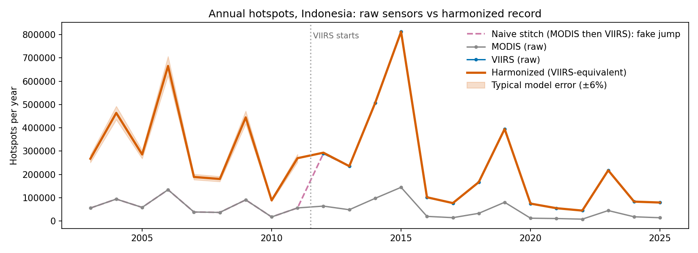
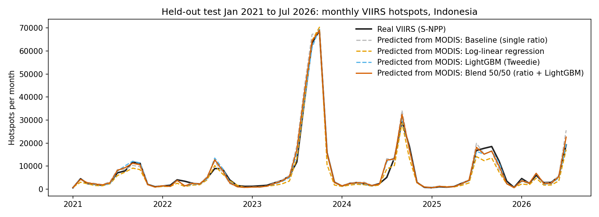
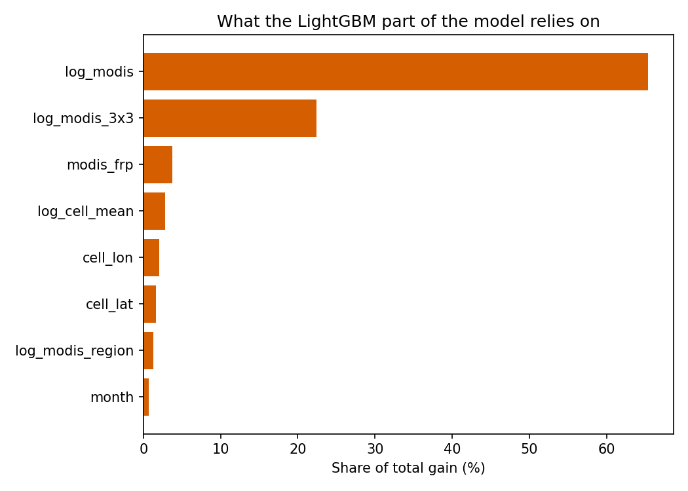

# ml/ - Harmonization model

**Owner: Shubhan**

Train a model that makes MODIS and VIIRS hotspot counts comparable, so the calendar shows one consistent series from 2003 to now.

## Plan

1. **Training data:** grid-cell months between 2012 and now when both sensors were running → pairs of (MODIS count, VIIRS S-NPP count) for the same cell and month.
2. **Models, in order:**
   - Baseline: one ratio, VIIRS ≈ k × MODIS
   - Log-linear regression: `log(1+VIIRS) ~ log(1+MODIS) + month + …`
   - LightGBM / XGBoost with MODIS count, mean FRP, month, lat, lon (+ land cover if available)
3. **Validate** with a time split (e.g. train 2012–2020, test 2021+). Report MAE and R² for all three models.
4. **Apply:** run the best model on the MODIS-only years (2003–2011) to get VIIRS-equivalent counts.
5. **Output:** `HARMONIZED` rows in `monthly_counts.csv` (see [../data/SCHEMA.md](../data/SCHEMA.md)).
6. **Extra (early warning):** flag months whose count is far above the multi-year median.

## Robustness checks

- MODIS confidence ≥ 30 vs ≥ 50 (from [../docs/data-quality-filters.md](../docs/data-quality-filters.md))
- MODIS Terra + Aqua vs Aqua-only (Aqua passes over at the same time of day as VIIRS S-NPP)
- Does the MODIS/VIIRS ratio drift after ~2020 (MODIS orbit drift)? If yes, train on 2012–2020 only.

## Files

| File | What it does | Runtime |
|---|---|---|
| [features.py](features.py) | Shared data loading, features, metrics | |
| [harmonize.py](harmonize.py) | **Final model**: evaluation, then harmonized outputs | ~2 min |
| [experiments.py](experiments.py) | Feature + settings search (time-series CV inside 2012–2020) | ~10 min |
| [loyo.py](loyo.py) | Leave-one-year-out test, used to choose the final model | ~5 min |

```
pip install pandas scikit-learn lightgbm matplotlib tabulate
python ml/harmonize.py
```

Or open a file in VS Code and run it cell by cell (`# %%`).

## Final model

**Blend: 50% single VIIRS/MODIS ratio + 50% LightGBM (Tweedie).**

- **LightGBM** learns cell-level and seasonal detail: MODIS count, MODIS in the 8 neighbouring cells, fire intensity, how fiery the cell usually is, location, month, region-wide activity.
- **The ratio** keeps totals honest in giant fire years. Decision trees cannot extrapolate beyond values seen in training, so LightGBM alone under-predicted 2015 by 18–21%.

## Results

**Leave-one-year-out** ([outputs/loyo.md](outputs/loyo.md)): hide each overlap year, train on the rest, predict it. Closest to the real use (train on all overlap years, apply to unseen 2003–2011).

| Model | Typical annual error | Worst year | Monthly MAPE |
|---|---|---|---|
| Single ratio | 7.4% | −16.9% | 13.8% |
| LightGBM | 6.5% | −18.0% | 13.1% |
| **Blend (final)** | **6.2%** | **−15.7%** | **12.0%** |

Every method misses some years by 10–17% (2015, 2020, 2025): the VIIRS/MODIS relationship itself varies from year to year (about 4.5× to 6.2×). The harmonized series shows this as a ±6% band.

**Other checks** ([outputs/metrics.md](outputs/metrics.md)): held-out 2021–2026, backcast 2012–2016, Aqua-only input (worse, so Terra + Aqua is kept). The 7 extra features in `experiments.py` did not help, so the simpler 8-feature set is used.





## Input / output

- Input: `../data/processed/cell_monthly_counts.csv` (from Jasmine's pipeline)
- Output:
  - `outputs/monthly_counts.csv`: Indonesia monthly series, `MODIS` / `VIIRS` / `HARMONIZED` (SCHEMA.md section 3). **The calendar reads this.**
  - `outputs/cell_monthly_harmonized.csv`: harmonized count per 0.25° cell per month (non-zero rows only, `source` = `VIIRS` or `MODEL`). For calendars of any area drawn on the map.
  - `outputs/metrics.md`, `validation.png`, `harmonized_series.png`: for the submission
